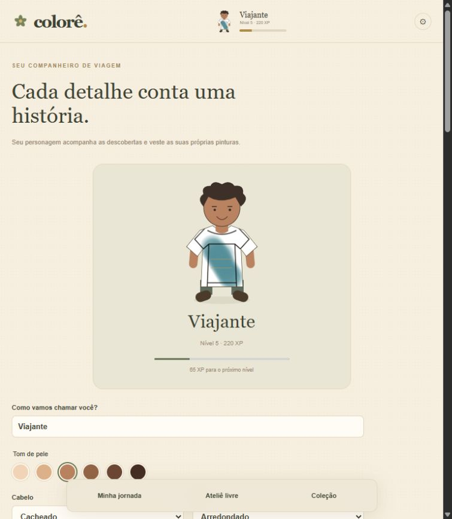
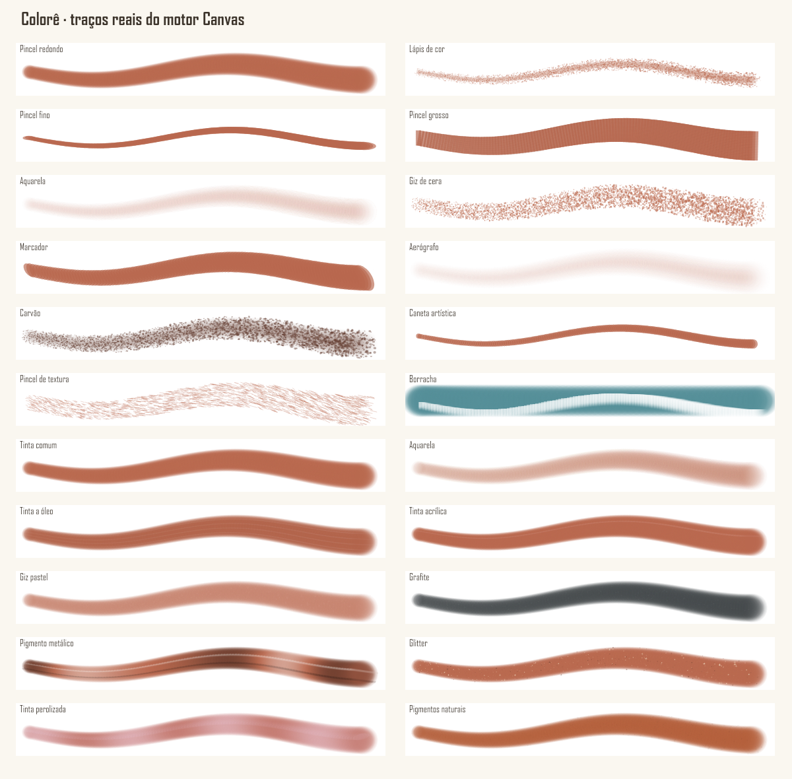
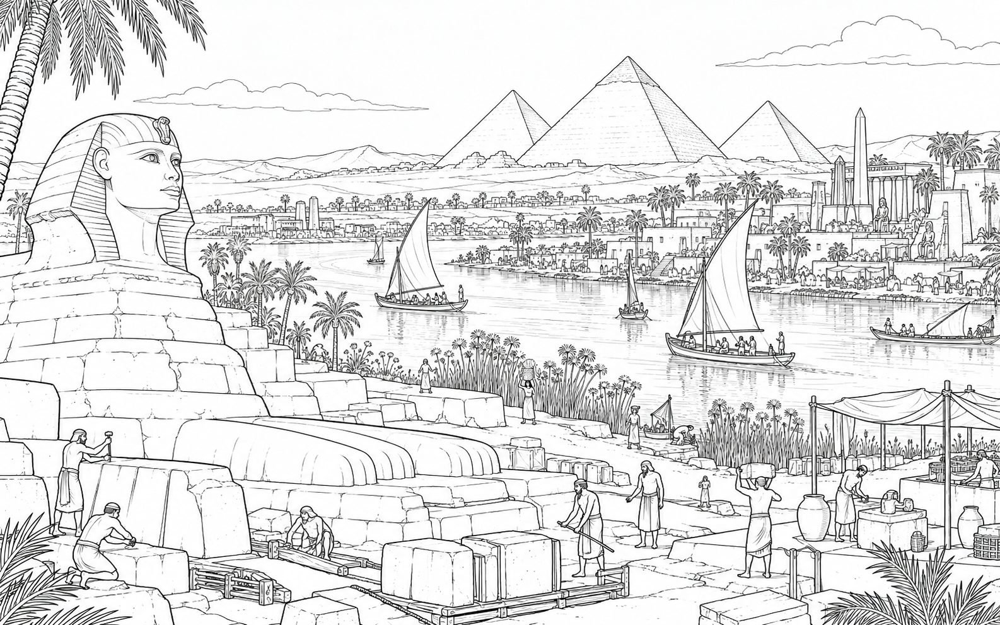
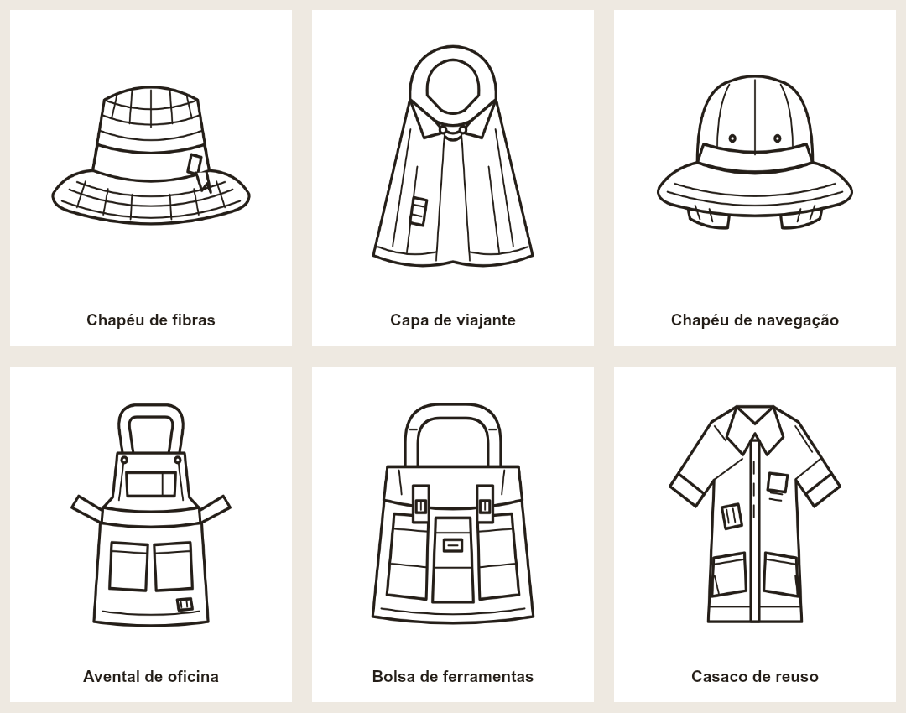

<div align="center">
  
  <h1>Colorê — O Caminho das Cores</h1>
  <p>Pinte histórias, descubra épocas e vista suas próprias criações.</p>
  <p><strong>React · TypeScript · Canvas 2D · React Native · Skia · SQLite</strong></p>
  <p><a href="https://colore-jardim-de-cores.pild.chatgpt.site/#jornada">Abrir o jogo</a> · <a href="#executar-na-web">Executar na web</a> · <a href="docs/ANDROID.md">Android e APK</a> · <a href="docs/STATUS-V6.md">Estado da entrega</a></p>
</div>

Colorê é um jogo de pintura livre e exploração histórica. Cada ilustração abre uma passagem para a próxima: das primeiras marcas ao redor do fogo às possibilidades de um amanhã sustentável. Você escolhe as cores, arrasta o pincel sobre o papel, cria seu personagem e pinta as roupas que ele usa durante a viagem.

A V6 evolui o protótipo existente para React e TypeScript. A pintura principal usa traços contínuos editáveis, com tinta sob os contornos. O código, as nove cenas e os dados da V5 continuam preservados; a [documentação anterior](docs/README-V5.md) explica a experiência por regiões.

> **Estado verificável:** a web funciona com pintura, SQLite, progresso, personagem, roupas e backups. O projeto Android tem renderizador nativo, configuração de APK e bundle verificável. **Ainda não há APK compilado nem teste em aparelho.** Há 15 caminhos e 75 ilustrações jogáveis; o [manifesto de assets](assets/illustrations/manifest.json) informa exatamente quais imagens estão disponíveis. Os masters gerados têm 1586 × 992, abaixo da referência solicitada de 2048 × 1280; não foram ampliados para simular HD. Consulte o [estado da entrega](docs/STATUS-V6.md) antes de distribuir.

## Veja o que está implementado

As imagens abaixo são capturas reais da web e uma amostra renderizada pelo motor de pintura. Não representam uma validação em celular Android.

| Personagem e roupa pintada | Ferramentas e materiais |
| --- | --- |
|  |  |



[Outra ilustração original para pintar: as primeiras marcas](assets/illustrations/p01-s01.png). Não há vídeo ou GIF de demonstração incluído nesta versão.

## Jogar

1. Crie seu viajante: nome, pele, rosto, cabelo, expressão, roupa, calçado e acessórios.
2. Abra **Minha jornada**, selecione um caminho e leia ou ouça a introdução.
3. Entre na primeira fase disponível. Arraste o mouse ou o dedo para pintar; escolha a cor livremente.
4. Ajuste o pincel, experimente sobreposições, apague partes ou use desfazer/refazer.
5. Ao considerar a obra pronta, confirme a conclusão. Você recebe XP pela primeira conclusão e libera a próxima etapa.
6. Volte à **Coleção** para continuar a mesma pintura. No **Ateliê**, crie outra versão de um cenário já descoberto ou pinte suas roupas.

A conclusão não compara sua pintura a uma referência. Cores inesperadas são bem-vindas. É preciso fazer uma pincelada e confirmar a ação; repetir uma fase não produz XP ilimitado. Ilustrações ainda não instaladas são identificadas e não abrem como fases prontas.

## Pintura, ferramentas e cores

A composição tem papel, camada de tinta, contornos em multiplicação e interface separada. A exportação inclui papel, tinta e desenho, sem os controles. O histórico guarda pontos, pressão, configurações e semente de textura de cada operação.

| Ferramenta | Comportamento |
| --- | --- |
| Pincel redondo | Ponta circular com cobertura e suavidade controláveis |
| Lápis de cor | Pigmento granulado e traço fino |
| Pincel fino | Ponta estreita orientada pelo gesto |
| Pincel grosso | Cobertura larga com marcas de cerdas |
| Aquarela | Transparência e acúmulo de pigmento |
| Giz de cera | Grãos e irregularidade de cobertura |
| Marcador | Traço relativamente uniforme |
| Aerógrafo | Névoa suave e difusa |
| Carvão | Grãos escuros e bordas fragmentadas |
| Caneta artística | Linha definida e contínua |
| Pincel de textura | Distribuição de marcas sobre a superfície |
| Borracha | Remove apenas a tinta, preservando os contornos |

Os dez materiais são tinta comum, aquarela, óleo, acrílica, pastel, grafite, metálico, glitter, perolizado e pigmento natural. Eles alteram cobertura, grão, relevo ou partículas; podem ser combinados com os pincéis. São aproximações gráficas 2D, sem simulação física de fluidos ou iluminação tridimensional.

Controles disponíveis: tamanho, opacidade, intensidade, suavidade, textura, mistura e alfa. O seletor inclui círculo HSV, luminosidade, saturação, RGB, HEX, cores recentes, conta-gotas e paletas favoritas. Paletas históricas são bônus opcionais: o círculo completo permanece disponível desde o início.

Na web, `Ctrl+Z` desfaz; `Ctrl+Shift+Z` ou `Ctrl+Y` refazem. Use a mão para mover a tela ou dois dedos para pinça e deslocamento. O modo de foco oculta o painel. No Android, um dedo pinta e dois dedos navegam; há adaptação para retrato e paisagem. Pressão é utilizada quando fornecida pelo dispositivo.

## Uma história em 15 caminhos

Cada caminho contém cinco fases exclusivas, apresentação, introdução e conclusão por fase, recompensa, paleta e ligação com o próximo capítulo. A jornada percorre contextos específicos de várias regiões; há sobreposições cronológicas. Os últimos cenários são possibilidades imaginadas, não previsões.

| Caminho | Tema |
| --- | --- |
| 01 | As Primeiras Marcas |
| 02 | O Nascimento das Aldeias |
| 03 | As Grandes Civilizações Fluviais |
| 04 | O Surgimento dos Conhecimentos |
| 05 | Cidades e Impérios Antigos |
| 06 | Povos e Civilizações do Mundo |
| 07 | A Era Medieval |
| 08 | Navegação e Transformações |
| 09 | O Renascimento das Artes |
| 10 | Ciência e Invenções |
| 11 | A Revolução Industrial |
| 12 | Um Mundo em Transformação |
| 13 | A Era da Tecnologia |
| 14 | O Mundo Contemporâneo |
| 15 | As Cores do Amanhã |

Os dados editoriais completos estão em [`content-source.mjs`](packages/game-content/content-source.mjs). As nove cenas anteriores inspiram composições e mantêm vínculos de migração. A abordagem evita apresentar a humanidade como história exclusiva de uma região; colonização, conflitos e desigualdade recebem contexto nos textos.

## XP, personagem e guarda-roupa

A curva possui 50 níveis, definidos por `round(20 × (nível − 1)^1.65)`. Uma fase inédita concede 120 XP; concluir as cinco fases de um caminho acrescenta 220 XP. A primeira descoberta de uma ferramenta ou material disponível concede 15 XP. Cada conquista concede 40 XP uma única vez.

O nível libera ferramentas e materiais. Pincel redondo, borracha, pigmentos naturais e escolha livre de cores estão disponíveis no início. As conquistas recompensam primeiras pinturas, caminhos completos, descoberta da aquarela, paletas favoritas e exploração dos materiais.

O avatar é modular e persistente. Há **nove peças pintáveis**: camiseta, chapéu de artista e bolsa de viagem iniciais; chapéu de fibras, capa, chapéu de navegação, avental, bolsa de ferramentas e casaco de reuso liberados por caminhos. Cada peça abre no mesmo editor, conserva traços editáveis e pode ser equipada no encaixe correspondente. As inspirações históricas são interpretações lúdicas, descritas em [Guarda-roupa](docs/GUARDA-ROUPA.md).



## Executar na web

Requisitos: Node.js compatível com Vite 7 (Node 22.19 foi utilizado), npm e navegador moderno com Canvas 2D, WebAssembly e armazenamento local habilitados. Não são necessárias chaves de API ou variáveis de ambiente para jogar.

```bash
git clone https://github.com/PedroHda/ColoringGame.git
cd ColoringGame
# Se a V6 estiver em revisão, use a branch da implementação:
git checkout codex/colore-free-paint
npm ci
npm start
```

Abra o endereço que o Vite imprimir, normalmente `http://127.0.0.1:4173/`. A porta pode mudar se já estiver ocupada.

```bash
npm run check       # TypeScript e sintaxe dos módulos preservados
npm test            # Regras, renderização, SQLite e regressões V5
npm run assets:check
npm run build       # Produz build/, ilustrações otimizadas e versão antiga
npm run preview     # Serve o build; confira a porta impressa
```

`npm run legacy` executa diretamente o protótipo V5 preservado em `dist/`. No build V6, ele fica em `/legacy/`. O argumento de URL `?v=5` sozinho não seleciona a versão antiga.

Para hospedar, publique o conteúdo de `build/` com MIME correto para JavaScript, PNG e WebAssembly. Use HTTPS, necessário para Service Worker e armazenamento seguro. O build é estático: não precisa de servidor Node em produção. `dist/` neste repositório contém a versão anterior e **não é a saída do Vite V6**. O checkout de publicação do Sites é separado do repositório principal.

## Android e APK

O aplicativo utiliza React Native e Skia. A superfície de pintura é nativa, com código de desenho específico para Android e regras/modelos compartilhados com a web. Não depende de WebView.

```bash
npm ci --prefix apps/mobile
npm run assets --prefix apps/mobile
npm run check --prefix apps/mobile
npm test --prefix apps/mobile
npm run bundle:android --prefix apps/mobile
```

Para desenvolver, execute `npm start --prefix apps/mobile` com um cliente de desenvolvimento instalado. `bundle:android` gera o bundle Hermes e confere assets; **não produz um APK**.

O identificador é `com.pedrohda.colore`. Ícones, splash, permissões e orientação estão em [`app.json`](apps/mobile/app.json). O perfil `preview` de [`eas.json`](apps/mobile/eas.json) gera especificamente `.apk`; `production` gera `.aab`.

```bash
cd apps/mobile
npm install --global eas-cli
eas login
eas init
npm run build:apk
```

O proprietário precisa vincular o projeto à sua conta Expo e configurar assinatura; nenhuma conta, credencial ou chave foi inventada ou incluída no repositório. Para build local, instale JDK e Android SDK, execute `npm run prebuild:android` e depois o Gradle. Os comandos, instalação via `adb`, assinatura, adaptação Windows e roteiro em aparelho estão em [Android e distribuição](docs/ANDROID.md).

Este ambiente não possui Java/JDK, Android SDK ou aparelho/emulador configurado. Por isso, não há APK anexado nem comprovação de execução nativa. A configuração e os comandos foram deixados reproduzíveis, conforme a exceção prevista na especificação.

## Arquitetura

```text
apps/
  web/                 React, editor Canvas, UI e worker SQLite/WASM
  mobile/              React Native, Skia, SQLite nativo, exportação e builds
packages/
  core/                XP, conquistas, migração V5, cores e guarda-roupa
  drawing-engine/      Modelo compartilhado e renderizador Canvas incremental
  database/            Esquema versionado e repositório SQLite da web
  game-content/        Narrativa, catálogo e contratos de caminhos/fases
  shared-types/        Obras editáveis e contrato de backup
assets/
  illustrations/       Masters, manifesto, prompts e inspeções
  clothing/            Nove SVG originais pintáveis
  characters/          Marca e recursos visuais
apps/mobile/assets/    Ícones, áudio original e cópias derivadas das ilustrações
scripts/               Validação, otimização e acabamento do build web
tests/                 Regressões do protótipo preservado e do pipeline
docs/                  Auditoria, dados, assets, Android e capturas reais
dist/                  Código e assets originais da V5 preservados
build/                 Saída V6 gerada e ignorada pelo Git
```

O modelo de documento é independente do renderizador. Web usa Canvas 2D; Android adapta as operações a Skia e reaproveita comandos de traços finalizados. As regras de XP, cores, catálogo, inventário e serialização são comuns. Os bancos possuem adaptadores e migrações próprios, com backup interoperável.

Tecnologias principais: React 19.2, TypeScript 5.9, Vite 7, SQLite WASM 3.50.4; Expo SDK 55, React Native 0.83, Skia 2.4, Gesture Handler e Reanimated. As versões exatas ficam nos dois arquivos de lock. `@napi-rs/canvas` é usado no computador para testes e otimização; não é o renderizador do aplicativo Android.

## SQLite, salvamento e backup

Na web, um worker é o único proprietário do SQLite. Usa OPFS SAH Pool quando disponível; o fallback mantém um banco SQLite real serializado em IndexedDB e só confirma a gravação após o término da transação. A abertura simultânea em outra aba apresenta uma mensagem de conflito quando o armazenamento está bloqueado. Não há cadastro obrigatório ou sincronização em nuvem.

As tabelas relacionam perfil, aparência, caminhos, fases, progresso, inventário, ferramentas, materiais, conquistas, XP, paletas, preferências, roupas, equipamento, obras, camadas, traços, migrações e cópias antigas. `drawings → layers → strokes` utiliza chaves estrangeiras e cascatas. O esquema web está na versão 2; o adaptador nativo, na versão 3. Esquemas futuros são recusados antes de alterar dados.

Ao terminar uma pincelada, o jogo salva operações editáveis. Não grava uma imagem completa em base64 por gesto. Traços já persistidos são reaproveitados; miniaturas são derivadas, geradas ao sair do editor ou sob demanda após restaurar um backup. Uma prévia assíncrona não sobrescreve pinceladas mais recentes.

**“Salvo” significa que a gravação terminou.** Um gesto em andamento ou ainda indicado como “Salvando…” pode ser perdido em um encerramento forçado. O SQLite preserva a última transação concluída. Limpar os dados do navegador, desinstalar o aplicativo ou políticas do sistema podem remover o armazenamento local: mantenha backups das obras importantes.

Em Ajustes, exporte um JSON com `format: "colore-backup"`, `version: 1`. Web e Android compartilham o formato: perfil, obras, pontos/pressão/sementes, histórico e cópias `legacy`. A restauração valida os dados e é transacional; o estado anterior é preservado em backup antes da substituição. PNG é uma imagem final para compartilhar, não um substituto do backup editável.

A migração V5 copia os registros `colore-*`, reconhece conclusões compatíveis e usa marcadores por fase para retomar importações parciais sem repetir XP. Pinturas antigas por regiões são preservadas e acessíveis na versão anterior; não são falsamente convertidas em pinceladas. Android recebe esses dados por backup da web, pois não acessa o `localStorage` do navegador. Veja [auditoria](docs/AUDITORIA-V6.md) e [validação dos dados](docs/VALIDACAO-DADOS-V6.md).

## Offline, desempenho e áudio

Na web, a interface é armazenada pelo Service Worker após a primeira carga bem-sucedida em HTTPS ou localhost. Ilustrações entram no cache ao serem abertas; Ajustes permite baixar as disponíveis. Para garantir uma viagem completa offline, faça esse download antes de desconectar. A instalação PWA depende do navegador. No Android, os assets validados acompanham o pacote.

A distribuição usa PNGs comprimidos sem perdas e miniaturas de 320 pixels para mapas e listas. A igualdade de pixels com os masters é verificada por hash RGBA. O editor carrega a resolução completa sob demanda. A interface evita atualizar React a cada movimento do cursor; o motor acrescenta marcas durante o gesto e preserva operações reproduzíveis. O benchmark automatizado de 1.500 movimentos é de CPU desktop, não de Android; desempenho e bateria em celulares modestos ainda precisam de medição.

Há volumes separados de música, efeitos e narração. Quatro ambiências harmônicas originais acompanham os períodos da jornada; efeitos curtos sinalizam ações e conclusões. Na web, são sintetizados via Web Audio; no Android, WAVs originais locais são reproduzidos com Expo Audio. A música começa desligada e pausa em segundo plano. O gerador está em `apps/mobile/scripts/generate-audio.mjs`.

A narração usa a síntese de voz do dispositivo, com texto sempre disponível. Vozes offline dependem do sistema e dos pacotes instalados. Não há chamada de IA ou serviço pago durante o jogo. Opções táteis respeitam a preferência do usuário e a disponibilidade do dispositivo.

## Produzir e acrescentar conteúdo

O [pipeline de ilustrações](docs/ASSETS.md) descreve cada verificação. Edite a composição específica em `content-source.mjs`, produza a arte e salve como `assets/illustrations/pNN-sNN.png`. Execute:

```bash
npm run assets:sync
npm run assets:check
# Exigência completa de quantidade e resolução:
node scripts/validate-assets.mjs --complete
npm run assets --prefix apps/mobile
```

A validação verifica presença, dimensões reais, identidade por hash, branco, cor e transparência. Exceções visuais precisam de revisão individual registrada. Um arquivo ausente permanece `asset: null`. `--complete` falha enquanto a quantidade ou a resolução mínima não atenderem ao contrato; falhas não são ocultadas pelo build jogável.

O gerador de imagens disponível entregou arquivos 1586 × 992. Os originais foram mantidos. Para concluir o requisito HD, substitua por masters de ao menos 2048 × 1280 produzidos na resolução adequada e valide novamente. O jogo não gera imagens em tempo de execução. Veja [distribuição sem perdas](docs/DISTRIBUICAO-ILUSTRACOES.md).

Para ampliar o jogo:

- **Caminhos/fases:** altere a fonte editorial, mantenha IDs estáveis e regenere catálogo/manifesto; reveja pré-requisitos, migração e textos de continuidade.
- **Pincéis/materiais:** acrescente o tipo e configuração no modelo, implemente comportamento real nos dois renderizadores, configure desbloqueio em `core` e verifique pixels, histórico e exportação.
- **Roupas:** crie SVG 512 × 512, registre item/encaixe/caminho em `packages/core/wardrobe.ts` e o `require()` em `NativePainting.tsx`; teste pintura, equipamento e backup.
- **Avatar:** edite os componentes `Avatar.tsx` de cada plataforma e os valores permitidos por `sanitizePlayer`; preserve compatibilidade com perfis salvos.
- **Recompensas/conquistas:** mantenha identificadores únicos e critérios objetivos no `core`; conceda XP uma única vez e cubra o roundtrip no banco.

## Qualidade e compatibilidade

Os testes automatizados cobrem regressões V5, serialização e interpolação, grãos determinísticos, diferença real entre ferramentas/materiais, pressão, mistura, borracha, PNG com contornos, desfazer/refazer, zoom, 75 etapas, XP sem repetição, migrações, transações, chaves estrangeiras, backup e reabertura de SQLite. A suíte nativa testa o contrato compartilhado e SQL das migrações em Node; isso não substitui executar os drivers nativos em aparelho.

A web foi exercitada no navegador com mouse: criação de perfil, pintura, salvamento, recarga, conclusão, roupa equipada e reabertura offline com o servidor desligado. Os registros de validação e as lacunas estão em [STATUS-V6.md](docs/STATUS-V6.md). Não se declara certificação de acessibilidade, compatibilidade universal ou taxa de quadros garantida.

Pendências de distribuição: masters HD, APK assinado, testes em Android de capacidades diferentes, pressão/caneta e gestos em hardware, memória/bateria, interrupções de áudio e auditoria completa de acessibilidade. Não há multiplayer, conta online ou sincronização automática entre aparelhos.

## Contribuir, créditos e licença

Antes de alterar dados persistentes, leia a auditoria e a documentação de migrações. Preserve IDs e obras existentes; mudanças de esquema exigem migração transacional e teste de rollback. Registre limitações reais. Para contribuir, descreva o problema e a solução, inclua imagens reais quando a interface mudar e execute os checks da plataforma afetada. Não versione credenciais, keystores, dados pessoais, `node_modules` ou outputs gerados.

Projeto de PedroHda e colaboradores. Direção artística e narrativa desenvolvidas a partir das referências do projeto; novas ilustrações produzidas com ferramenta de geração de imagens e revisadas individualmente. Roupas SVG e áudio procedural são originais do projeto. As dependências mantêm suas próprias licenças.

**O proprietário ainda não definiu uma licença de distribuição para o projeto.** A presença do código no GitHub não concede por si só permissão irrestrita de uso ou redistribuição. Nenhuma licença foi escolhida em nome do proprietário.

Documentação técnica: [React](https://react.dev/), [Vite](https://vite.dev/guide/), [SQLite WASM](https://sqlite.org/wasm/doc/trunk/index.md), [Expo](https://docs.expo.dev/), [Skia](https://shopify.github.io/react-native-skia/). Consulte os locks e a documentação Android deste repositório para as versões utilizadas.
