<div align="center">

# Colorê — O caminho das cores

**Respire. Pinte. Descubra.**

Uma aventura de pintura pela história humana, das primeiras marcas nas cavernas às cidades que criamos juntos.

**9 cenários · 3 capítulos · 3 dificuldades · Ateliê RGB · Texturas e brilhos**

[Jogar o protótipo](https://colore-jardim-de-cores.pild.chatgpt.site/?v=5#jornada) · [Rodar localmente](#rodar-localmente) · [Ver as fases](#jornada) · [Documentação técnica](#arquitetura)

</div>

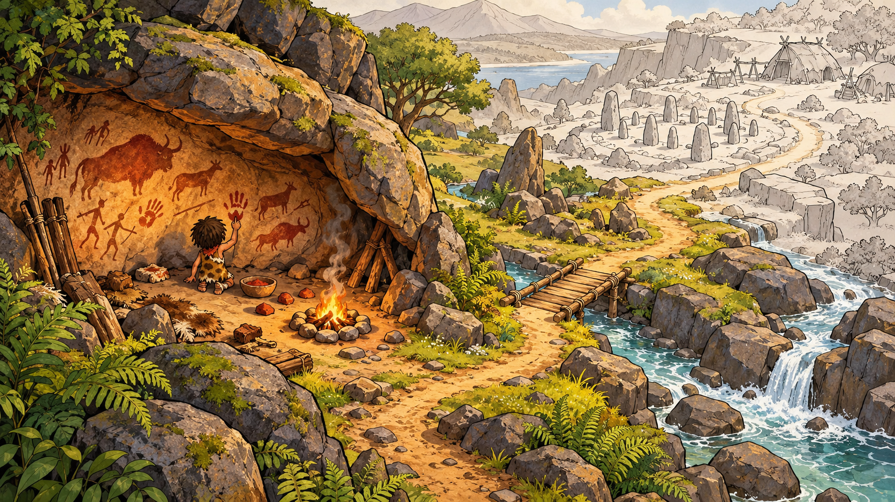

> **Versão atual: 5.0.0 — protótipo web jogável.** A jornada histórica, a pintura por números, o ateliê livre e a exportação de imagens já funcionam. O acesso à versão hospedada segue as permissões do site. Para executar sua própria cópia, use as instruções abaixo.

## Conteúdo

- [Sobre o projeto](#sobre)
- [Capturas do protótipo](#capturas)
- [Como jogar](#como-jogar)
- [Jornada e história](#jornada)
- [Galeria dos nove cenários](#galeria)
- [Dificuldades e recompensas](#dificuldades)
- [Ateliê livre, cores e materiais](#atelie)
- [Rodar localmente](#rodar-localmente)
- [Controles e acessibilidade](#controles)
- [Salvamento e exportação](#salvamento)
- [Tecnologias e arquitetura](#arquitetura)
- [Preparar ou alterar fases](#preparar-fases)
- [Verificações e testes](#verificacoes)
- [Hospedagem](#hospedagem)
- [Limitações e próximos passos](#limites)
- [Solução de problemas](#problemas)
- [Contribuição, artes e licença](#contribuicao)

<a id="sobre"></a>

## Sobre o projeto

Colorê é uma experiência de pintura com ritmo tranquilo. Cada cena começa em tons de papel e cinza e ganha cor conforme o jogador preenche suas regiões. As ilustrações mantêm contornos, sombras e textura durante a transformação.

A história acompanha as marcas que as pessoas deixam no mundo: pigmentos na pedra, cerâmica, monumentos, mosaicos, livros, telas, oficinas e espaços de criação coletiva. O personagem recorrente, os rios, as trilhas e as ruas ligam uma época à seguinte.

| Espaço | O que você encontra |
| --- | --- |
| **Minha jornada** | Pintura por números, fases em sequência, trechos da história e estrelas. |
| **Ateliê livre** | Todos os cenários disponíveis para experimentar cores, texturas e acabamentos. |
| **Coleção** | Acesso às cenas iniciadas ou concluídas, com filtros para jornada e ateliê. |

Não é necessário criar conta dentro do jogo. A execução do protótipo não faz chamadas a serviços de IA e não exige chave de API.

<a id="capturas"></a>

## Capturas do protótipo

As imagens abaixo são capturas reais da versão web. Elas mostram a interface responsiva e uma pintura em andamento.

<table>
  <tr>
    <th>Minha jornada</th>
    <th>Pintura por números</th>
  </tr>
  <tr>
    <td width="50%">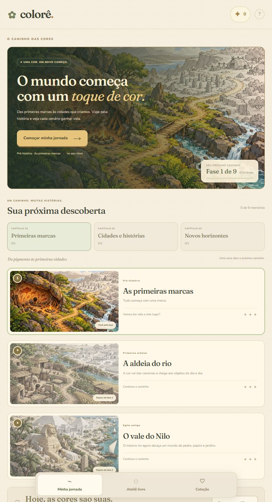</td>
    <td width="50%">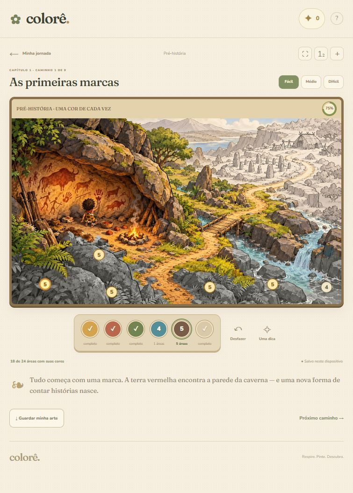</td>
  </tr>
</table>

Na segunda captura, a fase está em **75%**: a caverna e parte da paisagem já ganharam cor, enquanto as áreas restantes continuam em cinza.

<a id="como-jogar"></a>

## Como jogar

1. Abra o jogo e selecione **Começar minha jornada**.
2. Escolha **Fácil**, **Médio** ou **Difícil** na tela da cena.
3. Selecione um dos seis pigmentos e toque em uma região com o mesmo número.
4. Continue até preencher todas as áreas. Quando um pigmento termina, o jogo seleciona outro que ainda tem áreas pendentes.
5. Ao concluir, leia a continuação da história e use **Seguir o caminho** para avançar.

Escolher um pigmento diferente do solicitado exibe uma orientação e mantém o progresso. **Uma dica** destaca uma região disponível; **Desfazer** reverte a última pintura feita desde a abertura da cena.

Para experimentar suas próprias combinações, entre em **Ateliê livre**, escolha uma cena e use o painel de materiais. Para guardar o resultado, selecione **Guardar minha arte** e depois **Salvar PNG**.

<a id="jornada"></a>

## Jornada e história

As nove fases estão distribuídas em três capítulos. Cada conclusão apresenta uma descoberta e uma passagem narrativa para a próxima época.

| Capítulo | Fase | Cenário | Época | Ligação com o próximo caminho |
| --- | --- | --- | --- | --- |
| 1 · Primeiras marcas | 1 | As primeiras marcas | Pré-história | A trilha cruza o riacho e revela uma aldeia. |
| 1 · Primeiras marcas | 2 | A aldeia do rio | Primeiras aldeias | O rio conduz a um vale de monumentos e jardins. |
| 1 · Primeiras marcas | 3 | O vale do Nilo | Egito antigo | O curso do rio chega ao porto e ao mar. |
| 2 · Cidades e histórias | 4 | O porto das ideias | Grécia antiga | A estrada do porto segue até uma ponte de pedra. |
| 2 · Cidades e histórias | 5 | A ponte dos encontros | Roma antiga | A ponte aproxima cidades e leva a uma vila entre colinas. |
| 2 · Cidades e histórias | 6 | O jardim das histórias | Idade Média | A rua da vila se abre em uma praça de artistas. |
| 3 · Novos horizontes | 7 | A praça dos artistas | Renascimento | Os ateliês se aproximam de um bairro de oficinas. |
| 3 · Novos horizontes | 8 | A oficina dos novos tons | Era industrial | A oficina e o canal chegam a um espaço comunitário. |
| 3 · Novos horizontes | 9 | A cidade que criamos | Nosso tempo | Um mural reúne símbolos e memórias da viagem. |

Essa sequência é um recorte narrativo e visual. Ela não pretende representar toda a história humana ou uma trajetória única seguida por todas as sociedades.

<a id="galeria"></a>

## Galeria dos nove cenários

Estas são as ilustrações de base usadas nas fases. Elas mostram a direção de arte; a pintura do jogador é renderizada sobre essas imagens durante o jogo. Clique em uma imagem para abri-la em tamanho maior.

<table>
  <tr>
    <td width="33%"><a href="dist/history/images/01-primeiras-marcas.png"></a><br><strong>01 · As primeiras marcas</strong><br>Pré-história</td>
    <td width="33%"><a href="dist/history/images/02-a-aldeia-do-rio.png">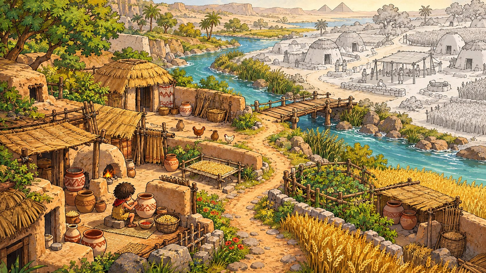</a><br><strong>02 · A aldeia do rio</strong><br>Primeiras aldeias</td>
    <td width="33%"><a href="dist/history/images/03-o-vale-do-nilo.png">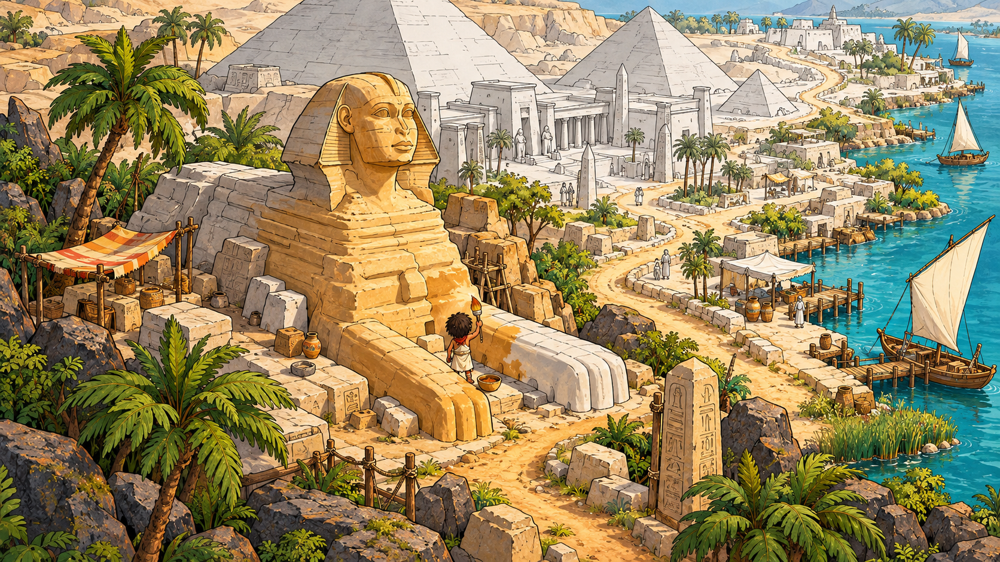</a><br><strong>03 · O vale do Nilo</strong><br>Egito antigo</td>
  </tr>
  <tr>
    <td><a href="dist/history/images/04-o-porto-das-ideias.png">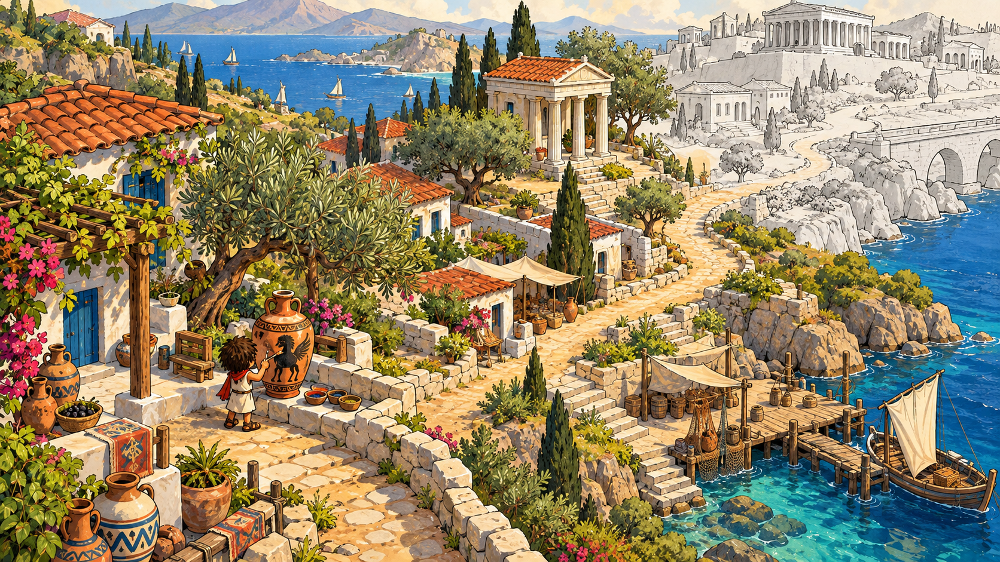</a><br><strong>04 · O porto das ideias</strong><br>Grécia antiga</td>
    <td><a href="dist/history/images/05-a-ponte-dos-encontros.png">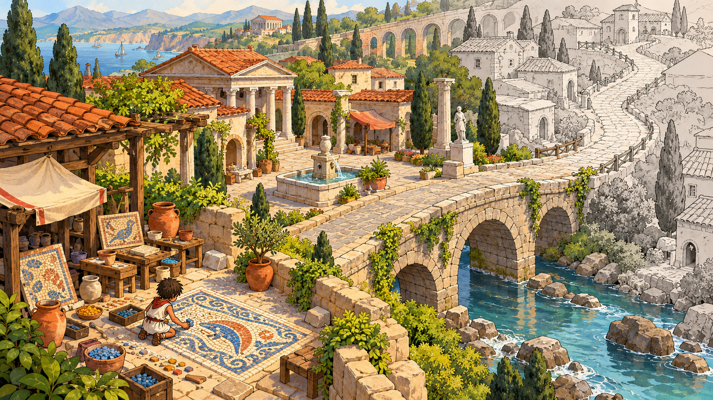</a><br><strong>05 · A ponte dos encontros</strong><br>Roma antiga</td>
    <td><a href="dist/history/images/06-o-jardim-das-historias.png">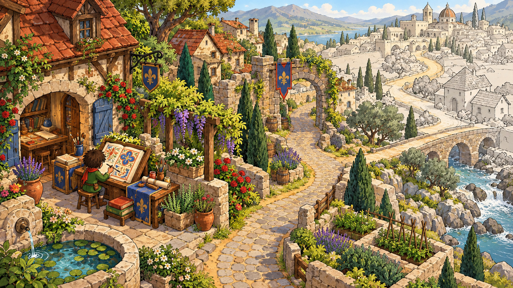</a><br><strong>06 · O jardim das histórias</strong><br>Idade Média</td>
  </tr>
  <tr>
    <td><a href="dist/history/images/07-a-praca-dos-artistas.png">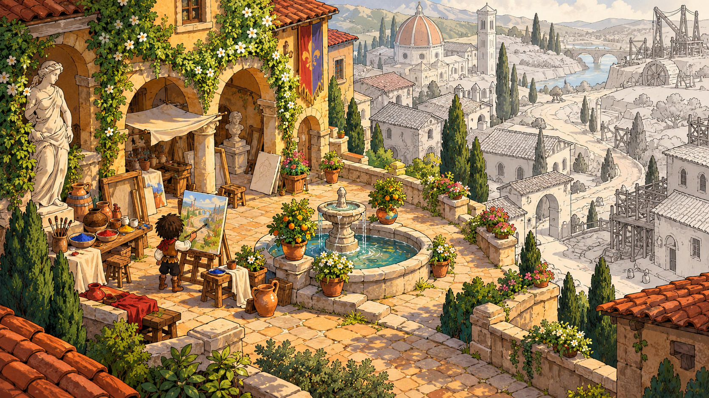</a><br><strong>07 · A praça dos artistas</strong><br>Renascimento</td>
    <td><a href="dist/history/images/08-a-oficina-dos-novos-tons.png">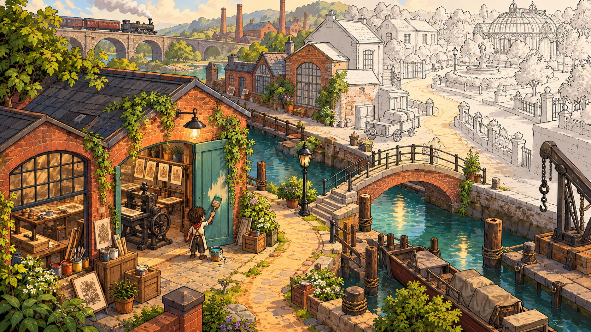</a><br><strong>08 · A oficina dos novos tons</strong><br>Era industrial</td>
    <td><a href="dist/history/images/09-a-cidade-que-criamos.png">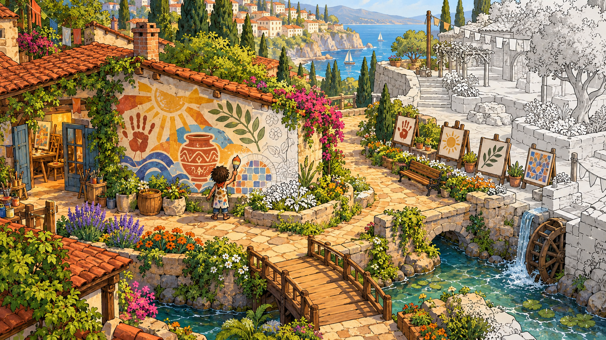</a><br><strong>09 · A cidade que criamos</strong><br>Nosso tempo</td>
  </tr>
</table>

<a id="dificuldades"></a>

## Dificuldades e recompensas

Cada cenário possui três mapas de pintura diferentes:

| Nível | Áreas por cena | Proposta |
| --- | --- | --- |
| **Fácil** | 24 | Menos divisões e áreas maiores. |
| **Médio** | 40 | Mais regiões para descobrir. |
| **Difícil** | 70 | Mais divisões e detalhes para preencher. |

São **27 mapas de regiões** ao todo. A jornada usa seis famílias de pigmentos em todos os níveis: ocre, terra vermelha, verde, azul, sombra de terra e areia.

- A primeira fase começa disponível; as seguintes exigem a conclusão dos caminhos anteriores.
- Concluir uma fase em **qualquer dificuldade** libera a próxima.
- Cada fase concluída vale **três estrelas**, até **27 estrelas** na jornada inteira.
- Concluir a mesma fase em outra dificuldade não acumula estrelas extras.
- Cada combinação de cena, modo e dificuldade guarda sua própria pintura. Trocar de nível não transfere o preenchimento para o outro mapa.
- O ateliê mantém todas as cenas disponíveis e não concede estrelas nem desbloqueia a jornada.

As estrelas são uma indicação de progresso. Não há loja ou sistema de compra de itens nesta versão.

<a id="atelie"></a>

## Ateliê livre, cores e materiais

O ateliê permite escolher qualquer uma das nove épocas, sem seguir a sequência da história. O jogador preenche ou recolore regiões com sua própria mistura.

### Cores

- Círculo de cores com matiz e saturação.
- Controle de luminosidade, incluindo branco e preto.
- Entrada hexadecimal no formato `#RRGGBB`.
- Canais **R**, **G** e **B**, de `0` a `255`.
- Histórico das últimas oito cores usadas.

O seletor trabalha internamente em HSV e converte o resultado para RGB/HEX. Não há controle de transparência alfa nesta versão.

### Texturas e brilhos

| Texturas | Acabamentos |
| --- | --- |
| Lisa | Fosco |
| Papel | Acetinado |
| Aquarela | Glitter |
| Tecido | Metálico |

Qualquer textura pode ser combinada com qualquer acabamento, formando **16 combinações por cor**. A escolha fica salva por região e aparece na exportação em PNG. Os brilhos são efeitos visuais estáticos.

Use **Preencher** para aplicar a mistura e **Borracha** para retirar a pintura de uma área. **Desfazer** restaura a ação anterior, incluindo recolorações e apagamentos, enquanto a cena permanecer aberta.

**“Livre” significa liberdade de cores e materiais sobre regiões predefinidas.** O protótipo ainda não oferece pincel de traço livre.

<a id="rodar-localmente"></a>

## Rodar localmente

### Requisitos

- **Node.js 22 ou superior**, com npm. Ambiente validado com Node.js `22.19.0` e npm `11.12.1`.
- Git, caso você use o comando de clonagem. Também é possível baixar e extrair o repositório como ZIP.
- Navegador com JavaScript, módulos ES, Canvas 2D e armazenamento local habilitados.

### Iniciar

```powershell
git clone https://github.com/PedroHda/ColoringGame.git
cd ColoringGame
npm start
```

Abra **http://127.0.0.1:4173**. Para encerrar o servidor, pressione `Ctrl+C` no terminal.

O projeto não possui dependências JavaScript externas: **não é necessário executar `npm install`**. Também não é necessário compilar a aplicação. Os arquivos de `dist/` são servidos diretamente.

Não abra `dist/index.html` pelo explorador de arquivos usando `file://`: os módulos e o carregamento dos mapas precisam de um servidor HTTP.

### Usar outra porta no PowerShell

Se a porta padrão estiver ocupada:

```powershell
$env:PORT = "4174"
npm start
```

Nesse caso, acesse **http://127.0.0.1:4174**. A variável vale para o terminal atual. O servidor escuta em `127.0.0.1`, portanto esse comando permite acesso apenas pela própria máquina.

### Comandos disponíveis

| Comando | Função |
| --- | --- |
| `npm start` | Inicia o servidor local na porta 4173 ou na definida em `PORT`. |
| `npm run check` | Verifica a sintaxe dos módulos principais e do servidor. |
| `npm test` | Executa os testes de `tests/*.test.mjs` com o runner nativo do Node.js. |

Python é opcional: só é usado ao recalcular os mapas das fases.

<a id="controles"></a>

## Controles e acessibilidade

| Ação | Mouse ou toque | Teclado |
| --- | --- | --- |
| Selecionar pigmento na jornada | Escolher uma cor na paleta | Teclas `1` a `6` com a cena aberta. |
| Pintar uma região | Clicar ou tocar na área ou no número | `Tab` até a área, depois `Enter` ou `Espaço`. |
| Navegar entre controles | Clicar ou tocar no controle | `Tab` e `Shift+Tab`. |
| Ajustar o tom no ateliê | Arrastar no círculo de cores | Com o círculo em foco, `←` e `→`. |
| Ajustar a saturação | Mover em direção ao centro ou à borda | Com o círculo em foco, `↑` e `↓`; `Home` e `End` para os extremos. |
| Desfazer, pedir dica ou ampliar | Usar o botão correspondente | Focar o botão e ativá-lo. |

A interface inclui rótulos para as áreas, foco visível, mensagens de status e indicação do pigmento por número. É possível ocultar os números na jornada, ampliar a cena e solicitar tela cheia quando o navegador permitir.

Em telas pequenas, a navegação se adapta e o painel do ateliê fica abaixo da pintura. Usar o celular na horizontal oferece mais espaço para os detalhes. Esses recursos não representam uma certificação de acessibilidade; a experiência ainda pode ser aprimorada com testes de uso e tecnologias assistivas.

<a id="salvamento"></a>

## Salvamento e exportação

### Progresso local

O jogo salva automaticamente em `localStorage`, na chave **`colore-history-v1`**. O estado inclui áreas pintadas, cores, texturas, acabamentos, preferências e cores recentes.

As pinturas são separadas por cena e dificuldade em duas coleções:

| Campo | Conteúdo |
| --- | --- |
| `numbered` | Identificadores das regiões preenchidas na jornada. |
| `free` | Cor, textura e acabamento aplicados às regiões no ateliê. |

Uma chave de pintura tem o formato `01-primeiras-marcas:easy`. Os registros passam por validação ao carregar; dados incompatíveis ou inválidos são descartados.

- **Salvo neste dispositivo** indica que o armazenamento foi gravado.
- **Apenas nesta sessão** indica que não foi possível persistir os dados.
- O histórico de **Desfazer** não é persistido: ele recomeça ao abrir ou trocar a cena/dificuldade.
- Navegadores, perfis, endereços e portas diferentes possuem armazenamentos separados.
- Limpar os dados do site remove o progresso. Não há conta, nuvem ou sincronização entre dispositivos.

As chaves anteriores, `colore-studio-v1` e `colore-freepaint-v1`, são preservadas. O progresso do protótipo vetorial antigo não é convertido para as novas fases históricas.

### Guardar uma pintura

Selecione **Guardar minha arte** para abrir a prévia e depois **Salvar PNG**. O arquivo tem **1600 × 1000 pixels**, com a pintura atual, os materiais aplicados, o título e a assinatura do Colorê. Áreas ainda não pintadas permanecem em cinza; os números de interação não fazem parte da imagem exportada.

A exportação funciona tanto para trabalhos parciais quanto para cenas concluídas. Ela guarda uma imagem do resultado, sem incluir o estado editável do jogo. Ainda não há importação ou exportação de backup do progresso.

<a id="arquitetura"></a>

## Tecnologias e arquitetura

| Tecnologia | Uso no projeto |
| --- | --- |
| **HTML5** | Estrutura da interface, controles, diálogos e navegação. |
| **CSS3** | Identidade visual, texturas de interface e layouts responsivos. |
| **JavaScript com módulos ES** | Regras, navegação, interação e persistência. |
| **Canvas 2D** | Renderização das cenas, aplicação de cores e materiais, exportação PNG. |
| **SVG** | Camada interativa dos números e prévias de materiais. |
| **JSON** | Mapas das regiões pintáveis nas três dificuldades. |
| **Node.js** | Servidor HTTP de desenvolvimento e testes automatizados. |
| **Python + Pillow + NumPy** | Preparação offline dos mapas de regiões a partir das ilustrações. |

O aplicativo é estático: não há backend de contas, banco de dados remoto ou framework de interface. As fontes Fraunces e Nunito são carregadas do Google Fonts; Georgia e Arial são alternativas locais.

### Estrutura do repositório

```text
ColoringGame/
├── dist/
│   ├── index.html                  # Entrada da experiência histórica
│   ├── favicon.svg
│   ├── paint-effects.js            # Conversões de cor e prévias dos materiais
│   ├── history/
│   │   ├── app.js                  # Interface, navegação, regras e diálogos
│   │   ├── painter.js              # Canvas, seleção de áreas e exportação
│   │   ├── state.js                # Persistência, progresso e leitura dos mapas
│   │   ├── scenes.js               # Fases, narrativa, capítulos e pigmentos
│   │   ├── style.css               # Visual e responsividade
│   │   ├── images/                 # Nove ilustrações PNG
│   │   └── regions/                # Nove JSON, cada um com três mapas
│   └── ...                        # Módulos e estilos do protótipo vetorial anterior
├── docs/
│   └── images/                     # Capturas reais utilizadas neste README
├── scripts/
│   └── build-history-regions.py     # Gerador dos mapas de pintura
├── tests/
│   ├── history.test.mjs             # Mapas, estado e progressão histórica
│   ├── difficulty.test.mjs          # Dificuldades do protótipo vetorial
│   ├── free-paint.test.mjs          # Cores, materiais e dados persistidos
│   └── progression.test.mjs         # Progressão do protótipo vetorial
├── .gitignore
├── package.json
├── README.md
└── server.mjs
```

### Como uma região recebe cor

1. `scenes.js` informa a imagem e o JSON da fase selecionada.
2. `painter.js` carrega esses arquivos e `state.js` descompacta o mapa da dificuldade.
3. O toque ou clique é convertido em uma posição na máscara de regiões.
4. Na jornada, o jogo verifica se o pigmento selecionado corresponde ao número da área.
5. O Canvas revela a ilustração original ou aplica a mistura do ateliê, preservando traços e luminosidade.
6. O estado é salvo e os indicadores de progresso são atualizados.

As máscaras têm **336 × 189 posições**, com regiões compactadas em RLE — pares de identificador e quantidade de posições consecutivas. As imagens são renderizadas em resolução maior. A posição de cada número é calculada no interior da sua região.

As regiões são agrupadas por cor e proximidade espacial; não são recortes manuais de cada objeto. Uma área pode reunir partes de objetos próximos. Na jornada, trechos neutros das ilustrações recebem pigmentos suaves para manter a transformação visual.

### Rotas da interface

| Fragmento da URL | Tela |
| --- | --- |
| `#jornada` | Apresentação, capítulos e fases. |
| `#livre` | Galeria do ateliê. |
| `#colecao` | Trabalhos iniciados ou concluídos. |
| `#colorir` | Cena atual, conforme o estado salvo no navegador. |

As rotas usam fragmentos e não exigem reescrita de URLs no servidor. `#colorir` não identifica sozinho uma fase compartilhável; a cena e o modo vêm do estado local.

<a id="preparar-fases"></a>

## Preparar ou alterar fases

Para mudar textos, títulos, pigmentos e ligações narrativas, edite `dist/history/scenes.js`. Para ajustar o visual da interface, use `dist/history/style.css`.

### Recalcular regiões das imagens existentes

Os mapas prontos já estão no repositório. Execute o gerador apenas quando precisar refazê-los, por exemplo após alterar uma ilustração.

Com Python 3 e pip disponíveis, na raiz do projeto:

```powershell
python -m pip install Pillow numpy
python scripts/build-history-regions.py
npm test
```

O script lê os PNG de `dist/history/images/`, calcula os três níveis e **regrava os JSON correspondentes** em `dist/history/regions/`. As ilustrações originais não são modificadas. As versões das dependências Python ainda não estão fixadas em um arquivo de requisitos.

Ao alterar máscaras ou identificadores, revise a compatibilidade dos dados salvos: o progresso armazena IDs das regiões, que podem passar a representar outras áreas após uma nova segmentação.

### Adicionar novas épocas

A estrutura atual foi preparada para nove cenas e três capítulos. Incluir uma fase exige atualizar as imagens, os mapas e a narrativa, além de revisar `state.js`, os limites e textos em `app.js` e os testes. Apenas adicionar um PNG não cria uma fase jogável completa.

<a id="verificacoes"></a>

## Verificações e testes

Execute na raiz:

```powershell
npm run check
npm test
```

A suíte usa `node:test` e `node:assert/strict`, sem bibliotecas extras. Os testes verificam:

- Sequência de desbloqueio e estrelas sem duplicação.
- Separação de pinturas por cena, modo e dificuldade.
- Validação de dados persistidos e rejeição de registros malformados.
- Cobertura de todos os pixels dos 27 mapas e conectividade de cada região.
- Quantidade de áreas por nível e posicionamento dos números dentro delas.
- Rejeição de mapas compactados incompletos ou que ultrapassem os limites da máscara.
- Conversões de cores, normalização de materiais e comportamentos do protótipo vetorial preservado.

A verificação de sintaxe e os testes não substituem a revisão visual no navegador. Para alterações de interface ou pintura, confira também toque/clique, navegação por teclado, troca de dificuldade, recarga da página e exportação PNG.

<a id="hospedagem"></a>

## Hospedagem

O conteúdo que precisa ser servido está em **`dist/`**. A publicação deve manter os caminhos relativos entre `index.html`, os módulos, as imagens e os mapas JSON. Não há etapa de build ou script `npm run build`.

O `server.mjs` é um servidor de desenvolvimento, limitado a loopback, com respostas sem cache. Na hospedagem estática, o próprio serviço entrega os arquivos de `dist/`; não é necessário executar esse servidor.

O jogo não requer serviços pagos ou APIs de IA durante a execução. Hospedagem e distribuição são serviços separados do código. As artes e os mapas estão no projeto; a única dependência externa de apresentação são as fontes opcionais. Não há service worker ou instalação PWA para garantir funcionamento offline.

<a id="limites"></a>

## Limitações e próximos passos

### Implementado

- [x] Nove cenários históricos com continuidade narrativa.
- [x] Três capítulos e desbloqueio sequencial.
- [x] Pintura por números em três dificuldades.
- [x] Ateliê com círculo de cores, HEX/RGB e cores recentes.
- [x] Texturas, brilhos, borracha e desfazer.
- [x] Coleção, progresso local e exportação em PNG.
- [x] Interface responsiva e controles de teclado.

### Possíveis próximas etapas

- [ ] Aplicativo móvel em Flutter, com interface e renderização próprias.
- [ ] Pincel de traço livre e ferramentas com comportamentos diferentes.
- [ ] Desbloqueio progressivo de instrumentos de pintura.
- [ ] Avatar personalizável e roupas pintáveis.
- [ ] Máscaras revisadas por objeto e aprimoramento das áreas de toque.
- [ ] Backup/importação de pinturas e sincronização opcional.
- [ ] Otimização das imagens e do desempenho em celulares.
- [ ] Ampliação da jornada com outras regiões, povos e perspectivas.

O visual atual tem profundidade de ilustração **2D**. O personagem faz parte das cenas; não há movimentação livre, mundo 3D, economia, compras ou multiplayer. A paleta indica pigmentos de referência: na jornada, a região recupera detalhes da arte em vez de receber uma cor chapada.

O repositório contém uma aplicação web, sem projeto Flutter, APK ou pacote para iOS. Uma versão Flutter poderá reaproveitar ilustrações, narrativa e dados das regiões, mas precisará adaptar renderização, interação e armazenamento.

<a id="problemas"></a>

## Solução de problemas

| Situação | O que conferir |
| --- | --- |
| `node` ou `npm` não é reconhecido | Verifique a instalação do Node.js e abra um novo terminal. |
| A porta 4173 está ocupada | Use outra porta com a variável `PORT`, conforme o exemplo de execução local. |
| A página não carrega ao abrir o HTML | Inicie com `npm start` e use o endereço HTTP informado no terminal. |
| “Esta cena não carregou agora” | Use **Tentar novamente** e confira se a imagem PNG e o JSON correspondente estão nos caminhos esperados. |
| Um toque não pinta na jornada | Selecione o pigmento do número indicado ou use **Uma dica**. |
| A próxima fase está bloqueada | Termine todas as áreas da fase anterior em qualquer dificuldade. |
| A pintura parece ter desaparecido | Confira modo, dificuldade, navegador, perfil e endereço, incluindo a porta. Cada combinação mantém dados separados. |
| Aparece “Apenas nesta sessão” | O navegador não conseguiu gravar no armazenamento local. Exporte a arte antes de fechar a página. |
| O desenho está pequeno no celular | Use **Ampliar cena**, gire o aparelho ou solicite tela cheia, quando disponível. |
| O PNG não é salvo imediatamente | Aguarde a prévia e use **Salvar PNG**; no celular, a imagem também pode ser mantida pressionada para salvar, conforme o navegador. |
| As fontes aparecem diferentes | O navegador pode estar usando as alternativas locais quando Google Fonts não está disponível. |

<a id="contribuicao"></a>

## Contribuição, artes e licença

Para propor uma mudança, descreva o problema e o comportamento esperado. Em alterações visuais, inclua capturas de antes e depois. Confira os comandos de verificação e mantenha a separação entre o progresso da jornada e o do ateliê.

Os módulos vetoriais da versão anterior continuam no repositório para preservar o trabalho e seus testes. A entrada atual, `dist/index.html`, carrega a experiência em `dist/history/`.

As nove ilustrações foram geradas com IA para esta direção de arte, a partir de referências visuais fornecidas durante a concepção. As capturas em `docs/images/` mostram o protótipo real. Arquivos de áudio pessoais e referências originais não fazem parte dos arquivos do jogo.

**Licença:** este repositório ainda não contém um arquivo `LICENSE` com condições de uso e distribuição definidas.

---

<div align="center">

**Colorê — cada cor deixa uma marca.**

</div>
